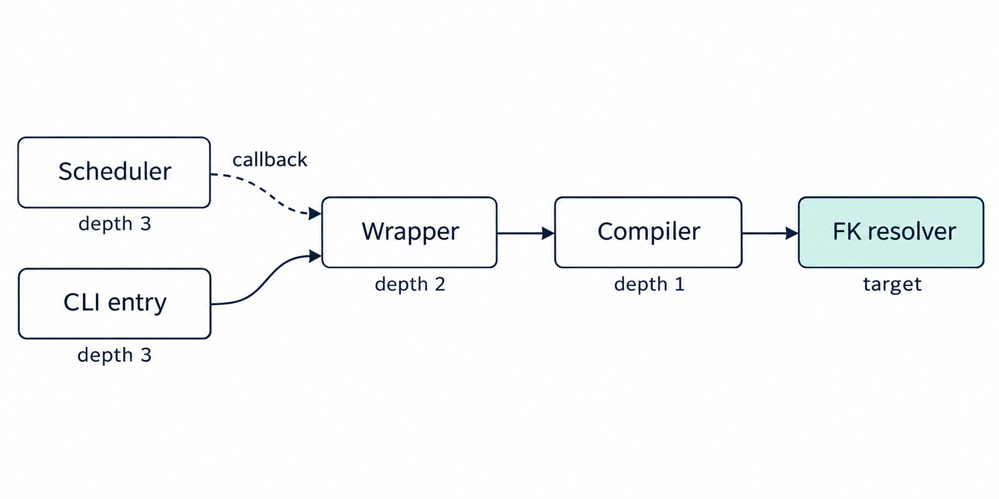

# code-ontology-bridge

A program is made of functions that call one another, and questions such as "if this function changed, which other functions would be affected?" are slow to answer by reading files. code-ontology-bridge reads Python source code and writes a database of its files, functions, classes, calls and imports, so that [NVIDIA Auto Ontology](https://github.com/NVIDIA/auto-ontology), NVIDIA's open-source system for answering questions about databases, can answer such questions. Auto Ontology's agent, an AI model that writes database queries, answers in SQL, so every answer arrives with the query that produced it and rows naming exact files and functions, which a person can rerun and read.

[See one question answered, step by step](https://wcook04.github.io/code-ontology-bridge/) · [Results](#results) · [Run it locally](#quickstart) · [Paper (PDF)](docs/case-study.pdf)

[Introduction to the projects](https://www.youtube.com/watch?v=FwgaZYH2otY) · [Code Ontology Bridge walkthrough](https://www.youtube.com/watch?v=zrVv-a8rT_s) · [Short demo](https://www.youtube.com/watch?v=9-5YJ6SoT4Y)

## How it works

```
Python source  →  cob (this package)  →  code database + table descriptions  →  Auto Ontology  →  answer: SQL + rows
```

| Piece | What it is | How Auto Ontology uses it |
| --- | --- | --- |
| **Code database** | A DuckDB file with 8 tables and 2 views: files, functions and classes, every call between them, imports, base classes, docstrings and test files. Every table has a declared primary key; foreign keys link calls to the functions they connect. | Connected through Auto Ontology's existing DuckDB connector, unmodified. |
| **Table descriptions** | A semantic model in Auto Ontology's own import format: what every table and column means, each table's key, and how the tables join. It describes tables, so its size does not grow with the codebase. | Loaded through Auto Ontology's existing model import (`POST /api/model/import`), unmodified. |
| **Ready-made queries** (optional) | Six SQL views over the code database, with their descriptions: direct calls and callbacks between each pair of functions, every function that can reach another and by how many calls, per-function and per-file summaries, which files import which, and class inheritance. In the code they are called the semantics layer. | Added to the database and described in the imported model, so the agent can select from them instead of writing recursive SQL. |

Auto Ontology's DuckDB connector at the tested revision reports no primary or foreign keys (`get_pks` and `get_fks` return empty tables), so the table descriptions also carry the keys and joins. Four of the six ready-made queries (call edges, reachability, class inheritance and the per-function caller count) are compared with a separate Python computation on 60 randomly generated codebases (120 test cases), including ones where functions call each other in a loop. The queries and these [tests](tests/semantics/) were committed before any study question existed; the queries' descriptions were extended after the study, which used the descriptions committed then.

<a id="one-question-all-the-way-through"></a>

## One question, answered

The [full CodeMap walkthrough](https://www.youtube.com/watch?v=OnBO9U9T2IQ) and [CodeMap short](https://www.youtube.com/watch?v=OC_DlpL7Xoc) show the private code map that inspired this bridge.

> If `resolve_semantic_fks` changed, which other functions in Auto Ontology would be affected, and through how many calls?

`resolve_semantic_fks` is the Auto Ontology function that resolves foreign keys (links between tables). Asked about a code database of its own source, Auto Ontology's agent returned four functions:

| Function | Steps to `resolve_semantic_fks` (calls or hand-overs) | How it gets there |
| --- | ---: | --- |
| `_run_semantic_compilation` | 1 | Calls it directly. |
| `run_semantic_compilation` | 2 | Calls `_run_semantic_compilation`. |
| `main` | 3 | Calls `run_semantic_compilation`. |
| `SemanticScheduler._run_once` | 3 | Hands `run_semantic_compilation` to `asyncio.to_thread`, which runs it. |

The fourth one never calls the chain by name. At line 203 of the scheduler it passes the function as an argument:

```python
tables_processed = await asyncio.to_thread(
    run_semantic_compilation, database_name
)
```

The extractor records this line as a **callback**: a function handed to another call that will run it. Because callbacks are rows of their own, one recursive query can follow the chain across three files, distinguish a call from a hand-over and report the number of steps. A text search finds the name but cannot tell a call from a hand-over or follow the chain.



In the figure, Compiler is `_run_semantic_compilation`, Wrapper is `run_semantic_compilation`, Scheduler is `SemanticScheduler._run_once`, CLI entry is `main`, and FK resolver is `resolve_semantic_fks`.

This question, from the earlier experiment, asked the agent to include callbacks; it shows that each hand-over is a row the agent can follow. The saved request, the SQL the agent wrote and its rows are in [ask_q11.json](examples/auto-ontology/live/current/responses/10i_ask_with_key/ask_q11.json).

The blind study tests the same capability without a hint. A separate AI author asked which functions Auto Ontology's query pipeline hands over to be run later (`ao-02`). Auto Ontology's agent, given only the code database, answered correctly in all 3 runs; the same model asked directly answered correctly in 1 of 20 runs across four briefings.

## Results

The study asked 48 questions about four open-source Python codebases: Auto Ontology, click, httpx and rich. An answer counts as **correct** when its SQL returns the right rows on all of these:

- the real code database;
- eight altered copies of it, which add calls, callbacks, classes and functions with duplicate names and remove some calls, so that most queries matching the right rows by luck fail.

Separate AI models wrote the questions and their answer keys from the source code and the bare code database, without seeing the table descriptions or the ready-made queries. A second AI model re-derived every answer from the question wording; on the real databases all 48 matched. The questions, answer keys and [protocol](study/PROTOCOL.md) were committed (`37b4f05`) before any test ran.

**Inside Auto Ontology, with only the code database connected, the agent with DeepSeek v4.1 Flash answered 10.3 of the 12 questions about Auto Ontology's own code correctly** (mean of three runs), and 11.7 of 12 on the real database. It answered 9 of the 12 correctly in every run, including three of the six questions their author rated hard. The same model asked directly, outside Auto Ontology, answered 3.2, and 6.4 with its best briefing. This compares the two complete setups: Auto Ontology's agent adds retrieval, validation and repair of failed queries, and ran with the provider's default temperature and reasoning settings.

**Asked directly, the table descriptions lift DeepSeek from 18.0 to 27.2 of all 48 questions** (mean of five runs); counting only the real database, from 28.6 to 41.6. With the descriptions, 9 questions improve and 1 gets worse. For NVIDIA Nemotron 3.5 Lightning the descriptions and ready-made queries are the best briefing, raising it more than threefold, from 2.4 to 7.6 (6 questions better, none worse), and from 3.6 to 11.8 on the real database.

The study scored 2,136 saved answers over four codebases (838 files, 9,815 functions and classes, 50,100 call rows), rerunning on the eight altered databases every answer that was right on the real one. All 1,920 answers from the models asked directly cost $0.48 in total.

**Asked directly** (all 48 questions, correct answers, mean of five runs). Each row gives the model more information about the database:

| The model is given | DeepSeek v4.1 Flash | NVIDIA Nemotron 3.5 Lightning |
| --- | ---: | ---: |
| Table names only | 18.0 | 2.4 |
| + table descriptions | **27.2** | 5.4 |
| + ready-made queries, without descriptions | 25.4 | 2.8 |
| + table descriptions and ready-made queries | 26.8 | **7.6** |

**Inside Auto Ontology** (the 12 Auto Ontology questions, correct answers, mean of three runs). Every row starts from the same code database; the last row also adds the six ready-made queries to it:

| Auto Ontology is given | DeepSeek v4.1 Flash | NVIDIA Nemotron 3.5 Lightning |
| --- | ---: | ---: |
| The code database, nothing imported | 10.3 | 0.7 |
| + table descriptions | 8.7 | 2.3 |
| + table descriptions and ready-made queries | 10.7 | 2.3 |

For DeepSeek, the descriptions alone scored 8.7 (runs of 8, 9 and 9) against 10.3 with nothing imported (10, 10 and 11); adding the ready-made queries recovered two questions with none lost, giving 10.7 (10, 12 and 10, one run answering all 12). For Nemotron, either import raised the score from 0.7 to 2.3, and the number of Auto Ontology questions it answered correctly at least once from 1 to 6 with the descriptions and to 7 with the descriptions and ready-made queries. Nemotron, the default model family in Auto Ontology's configuration, ran at temperature 0 with reasoning off when asked directly and with the provider's default settings inside Auto Ontology; most of its wrong answers are queries that run and return the wrong rows.

### Answer-key audit

After the runs, an outside reviewer found that one answer key ignored its question's "functions or methods" condition. Four further AI auditors, who saw no scores, then compared every answer key with its question: 21 of the 48 gained a condition the question states, and 5 of the 48 questions now accept either of two readings. The question writers and the second model had agreed on every answer on the real databases; the missing conditions change results only on the altered copies. The corrections were committed (`9097b80`) before rescoring, no model was asked again, and they moved results in both directions: Auto Ontology's 10.3 was 7.3 before, and the direct result with descriptions was 34.0. Both score sets are published ([what changed](study/PROTOCOL.md#corrections-after-the-runs)).

Every question, answer key, saved answer and score is in [study/RESULTS.md](study/RESULTS.md).

## Quickstart

Building the code database and querying it needs no model and no credentials. Install [uv](https://docs.astral.sh/uv/) and use Python 3.12:

```sh
git clone https://github.com/wcook04/code-ontology-bridge.git
cd code-ontology-bridge
uv sync --locked
mkdir -p build
uv run cob build code_ontology_bridge --out build/codemap.json --summary build/summary.json
uv run cob export-duckdb --codemap build/codemap.json --out build/repository.duckdb
uv run cob export-model --codemap build/codemap.json --out build/repository.model.yaml --database repository
uv run cob semantics --duckdb build/repository.duckdb --model build/repository.model.yaml --out-model build/repository.with-queries.model.yaml
```

These commands map this package's own source. `cob build` reads the source, `cob export-duckdb` writes the code database, `cob export-model` writes the table descriptions, and `cob semantics` adds the ready-made queries to the database and writes a second set of descriptions that also covers them. To map another codebase, replace `code_ontology_bridge` with its source folder.

Then ask which functions lead to `summarise`, the function that counts the rows in a code map:

```sh
uv run python - <<'PY'
import duckdb

with duckdb.connect("build/repository.duckdb", read_only=True) as db:
    rows = db.execute("""
        SELECT caller_symbol_id, direct_depth, any_depth
        FROM code.reachability
        WHERE target_symbol_id = 'codemap/builder.py::summarise'
        ORDER BY any_depth, caller_symbol_id
    """).fetchall()
for caller, direct, any_ in rows:
    print(f"{any_}  {'-' if direct is None else direct}  {caller}")
PY
```

Each line shows the fewest calls from that function to `summarise` counting callbacks, then the fewest through direct calls only, then the function. `cli.py::build_parser` and `cli.py::main` show a dash in the second column: `build_parser` registers each `cmd_*` command function as a callback (`set_defaults(func=cmd_build)`), so they reach `summarise` only through callbacks.

<a id="build-the-exports-locally"></a>

### Load it into Auto Ontology

[`run_live.sh`](examples/auto-ontology/live/run_live.sh) does these four steps against a local Auto Ontology; the [reproduction guide](docs/reproduction.md) lists what it needs (PostgreSQL, model credentials and the compatibility patch described below).

1. Copy the code database to a file Auto Ontology's DuckDB version can read ([`make_compat_duckdb.py`](examples/auto-ontology/live/make_compat_duckdb.py); the bridge writes DuckDB 2.0 files, Auto Ontology at `cdaf61e` reads 1.5, and the copy keeps every table, view and key).
2. Start Auto Ontology's ingestion service with `CONNECTION_STRINGS=duckdb:///<absolute path>/<copy>.duckdb`, so it catalogs the code database through its DuckDB connector.
3. Rewrite the table descriptions' catalog IDs to the IDs the server gave those tables ([`remap_catalog_ids.py`](examples/auto-ontology/live/remap_catalog_ids.py)). Without this step the import tries to create the catalog entries (the database and its tables) a second time and fails on Auto Ontology's unique-name constraints.
4. Send the YAML to `POST /api/model/import?replace=false` with content type `application/x-yaml`.

## Compatibility with Auto Ontology

| Task | What it needs |
| --- | --- |
| Build and query the code database, write the table descriptions | This package alone (DuckDB and PyYAML). |
| Reproduce the recorded Auto Ontology runs | Auto Ontology at [`cdaf61e`](https://github.com/NVIDIA/auto-ontology/tree/cdaf61e1bd0cf3820d11d72b43bb460816aebbd3) (3 November 2026) with the [compatibility patch](examples/auto-ontology/live/upstream-fix/README.md), PostgreSQL and model credentials. |
| Use the current Auto Ontology `main` | Untested. |

The DuckDB connector and the model import ran unmodified. The patch, twelve file diffs including tests (611 upstream tests in the query, chat and utility scopes pass), makes five changes, of which the recorded runs needed three: it lets each model role use any OpenAI-compatible service (the runs used OpenRouter), it passes Auto Ontology's existing SQL-only option through the chat API so code questions go to the SQL pipeline, and it extends an existing validator that rejects placeholder text such as "TODO" in answers.

Two findings for Auto Ontology came out of the integration. At `cdaf61e` the DuckDB connector's `get_pks` and `get_fks` return empty tables even when the database declares its keys, so the code database can serve as a test fixture for the DuckDB key work in [#333](https://github.com/NVIDIA/auto-ontology/issues/333). And importing a model onto an already ingested catalog fails on unique catalog names unless the model's catalog IDs are first rewritten to the server's IDs, which [`remap_catalog_ids.py`](examples/auto-ontology/live/remap_catalog_ids.py) does.

## Limits

- The questions were written by AI models under the protocol's rules, not by the codebases' maintainers. Inside Auto Ontology there are 12 questions.
- The answer keys are correct for the code database. The extractor reads source text, so it misses calls made dynamically, calls through a local alias and names reached through package re-exports, and a recorded callback is not proof that the function runs. Test files are linked to code by imports and file names; the links do not measure coverage ([all source-analysis limits](GAPS.md#source-analysis-limits)).

## Evidence

| Evidence | What it is |
| --- | --- |
| [The study](study/) | The 48 questions above, every saved answer and score, and the protocol. The current evidence. |
| [Earlier experiment](examples/auto-ontology/live/RESULTS.md) | 38 author-written questions about Auto Ontology, 22 for development and 16 held out, one run per setting. Kept as history, with [its protocol](docs/experiment-protocol.md). The example above and the website's walkthrough come from [its recorded development run](examples/auto-ontology/live/current/). |

<a id="serve-data-for-a-website"></a>

The commands `cob inspect-export`, `cob inspect-publish` and `cob inspect-serve` build a read-only local API and a static copy of the recorded walkthrough for browsing, with no model credentials ([inspection API](docs/inspection-api.md)). Separate [governance commands](docs/governance.md) record which descriptions a person has approved and annotate a generated SQL query with the descriptions it appears to rely on.

## Find your way around

| Folder | What it holds |
| --- | --- |
| [code_ontology_bridge/](code_ontology_bridge/) | The extractor, the database and description exporters, the ready-made queries, the inspection API and the governance commands. |
| [study/](study/) | The study: protocol, questions, answer-key corrections, runners, every saved answer and scores. |
| [examples/auto-ontology/](examples/auto-ontology/) | The code database of Auto Ontology, the live runner, the compatibility patch and the earlier runs. |
| [docs/](docs/README.md) | The paper, figures and task guides. |
| [eval/](eval/) | Questions of the earlier comparison. |
| [site/](site/README.md) | The reading website. |
| [tests/](tests/) | Package tests and optional tests against an Auto Ontology checkout. |
| [tools/](tools/) | Repository layout rules, the paper builder and [publication tools](docs/deployment.md). |
| [SPEC.md](SPEC.md) / [GAPS.md](GAPS.md) | The interface specification / current limits and remaining work. |

Run `uv run pytest -q -ra` for the tests and `uv run python tools/check_repository.py` for the layout rules. See [contributing](CONTRIBUTING.md) and the [paper's source](docs/case-study.md).

## Credits and licence

By Will Cook. The extractor adapts the source map from CodeMap, his earlier tool for navigating source code. [Apache License 2.0](LICENSE). This is an independent integration with NVIDIA's open-source project and is not affiliated with or endorsed by NVIDIA.
