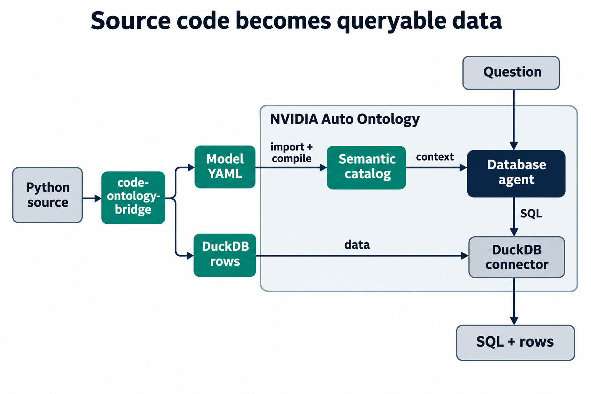

# code-ontology-bridge

**Make a Python repository queryable by NVIDIA Auto Ontology's SQL agent.**

code-ontology-bridge reads a Python repository and writes two files that [Auto Ontology](https://github.com/NVIDIA/auto-ontology) already imports: a DuckDB database of the code's files, functions, methods, classes, calls, imports, base classes, docstrings and test links, and a semantic model in Auto Ontology's own YAML format that says what each table and column means and how the tables join. Auto Ontology needs no code-specific connector: its existing model import and DuckDB connector take it from there. The model also carries the table keys and joins: at the pinned revision Auto Ontology's DuckDB connector reports no primary or foreign keys (`get_pks` and `get_fks` return empty tables), so the exported model declares a key for each of the 10 tables and 10 joins, such as `code.calls.callee_symbol_id` → `code.symbols.symbol_id`.

**What the study shows.** Four repositories (NVIDIA Auto Ontology, click, httpx and rich), 48 questions written by four separate AI authors who saw the source and a bare database but never what this project adds, each answer re-derived by an independent annotator, and everything frozen and pushed before any model saw a question ([protocol](study/PROTOCOL.md)). Two scores: **exact rows** on the repository's database, and **robust**, where the same SQL must also return the right rows on eight altered copies of that database (extra calls and callbacks, same-named functions, removed edges, changed docstrings), so an answer cannot be right by coincidence.

A model asked directly, all 48 questions, robust answers, mean of five runs:

| The model is given | DeepSeek v4.1 Flash | NVIDIA Nemotron 3.5 Lightning |
| --- | ---: | ---: |
| Schema only | 20.6 | 2.4 |
| + this project's base model (descriptions, keys, joins) | **34.0** | 5.6 |
| + this project's semantics layer (verified views and definitions) | **33.8** | **9.4** |

Inside NVIDIA Auto Ontology's own agent, the 12 Auto Ontology questions, robust answers, mean of three runs; only the imported model changes:

| Auto Ontology is given | DeepSeek v4.1 Flash | NVIDIA Nemotron 3.5 Lightning |
| --- | ---: | ---: |
| Nothing imported (its own catalog of the database) | 7.3 | 1.3 |
| + this project's base model | 7.3 | 2.0 |
| + this project's semantics layer | **8.7** | **2.7** |

Asked directly, both of this project's models lift both language models a long way above the schema: DeepSeek gains 13 robust answers, 14 questions improve and one regresses. The semantics layer ties the base model for DeepSeek and is the best briefing for Nemotron, where 8 questions improve and none regress. Inside Auto Ontology, the semantics layer gives the highest robust score for both models. For DeepSeek the base model adds nothing to what Auto Ontology finds by itself, and only the semantics layer raises the score; for Nemotron both imports raise it, from 1.3 to 2.0 and 2.7. Every number, question and response is in [study/RESULTS.md](study/RESULTS.md).

[Open the website](https://wcook04.github.io/code-ontology-bridge/#/study) · [Read the results](study/RESULTS.md) · [Read the protocol](study/PROTOCOL.md) · [Read the paper](docs/case-study.md) · [Build the exports locally](#build-the-exports-locally)

**What it does not show.** The questions were written by AI authors under the protocol's rules, not by the repositories' maintainers. Reference answers are correct for the extracted database; the authors' source checks found extractor misses (calls through local aliases, overloaded functions, package re-exports), listed per question. Nemotron scores low throughout on these questions with reasoning switched off. The Auto Ontology comparison uses 12 questions and three runs, so its differences are small in absolute terms. Auto Ontology ran at `cdaf61e` with a twelve-file compatibility patch; extraction and export need neither the patch nor model credentials.

## What each part contributes

| Component | Responsibility |
| --- | --- |
| **NVIDIA Auto Ontology** | Retrieves semantic context, generates SQL and executes it through its database connectors. |
| **This bridge** | Extracts Python source facts and exports the rows, table descriptions and relationships that make them queryable. |
| **Compatibility patch** | Configures public model clients and forwards the existing SQL-only route through the chat API for the recorded run. |

## One question, all the way through

Start with this operation in the pinned scheduler, at line 203:

```python
tables_processed = await asyncio.to_thread(
    run_semantic_compilation, database_name
)
```

The extractor records it in `code.calls` with `call_kind: callback`,
`resolution: imported`, and `confidence: low`. The caller is
`SemanticScheduler._run_once`; the callee is `run_semantic_compilation`.
The row records a function passed as an argument, not an observed execution.

The following is a short paraphrase, not the complete submitted request:

> Which callers reach `resolve_semantic_fks`, directly or indirectly, outside tests, and at what shortest depth?

The submitted request specified exact output fields and explicitly instructed the agent to follow resolved calls backwards, recursively, including callback references. With that guidance, Auto Ontology generated recursive SQL and returned four callers. The diagram uses short role names: arrows point toward the foreign-key resolver, and the query follows them in reverse. The dashed edge is a callback reference; solid edges are direct calls.


[Open the diagram at full size](docs/figures/caller-chain.png).

| Caller role | Depth |
| --- | ---: |
| Compiler | 1 |
| Wrapper | 2 |
| Scheduler | 3 |
| CLI entry | 3 |

<details>
<summary>Exact source symbols</summary>

| Diagram label | Source symbol |
| --- | --- |
| Scheduler | `SemanticScheduler._run_once` |
| CLI entry | `main` |
| Wrapper | `run_semantic_compilation` |
| Compiler | `_run_semantic_compilation` |
| FK resolver | `resolve_semantic_fks` |

The resolver is the query's starting point, not a returned caller.

</details>

The scheduler passes the wrapper to `asyncio.to_thread`. Recording that callback reference lets the query reach the scheduler as well as ordinary callers. The [saved response](examples/auto-ontology/live/current/responses/10i_ask_with_key/ask_q11.json) contains the question, generated SQL, complete symbol IDs and returned depths.

This demonstrates querying recorded relationships, not independently discovering the traversal strategy. These are relationships in a static source map; the diagram does not show observed execution or establish complete runtime impact analysis.

## How the exports connect



[Open the architecture diagram at full size](docs/figures/architecture.png).

The two exports have different jobs: **DuckDB supplies data; model YAML explains it**. Importing YAML alone does not connect a database. A third export supplies DDL, CSV data and reference questions in NVIDIA's evaluation format; the full upstream benchmark harness has not been run.

**A function is a row; Code symbol is a semantic term.** The frozen native model
maps `cob:auto_ontology_code:term:symbols` to
`cob:auto_ontology_code:table:code.symbols`. Call site maps to `code.calls`;
semantic foreign keys connect its caller and callee columns to the symbol-ID
attribute. The model has eight entity terms, not one term per function.
A function's docstring is a data value in `summary`; the authored description of
that column explains what the value means.

[Inspect the frozen model YAML](examples/auto-ontology/live/current/inputs/model.yaml)
or use the [model and Q11 inspection resources](docs/inspection-api.md).
The exported YAML, remapped import payload and compiled catalog are separate
stages; the inspector marks uncaptured stages explicitly.

The source-map approach comes from **CodeMap**, Will Cook's earlier source-navigation tool. This package adapts it into a standalone extractor. It reads existing docstrings, preserves missing descriptions as empty values and requires no private CodeMap service.

Separate [governance commands](docs/governance.md) record checks and annotate SQL; they do not enforce certified-only querying.

## Earlier experiment

Before the study, an earlier experiment asked 38 questions written by this project's author about Auto Ontology's code, one run per arm. It found the same direction (the exported model raised Nemotron's held-out score from 6 to 13 of 16 and DeepSeek's from 13 to 16) and taught the study's design: questions written blind to the system, a second annotator, repeated runs, counterfactual databases and the semantics layer. Its protocol, every response and the discarded attempts are kept in [docs/experiment-protocol.md](docs/experiment-protocol.md) and [the earlier results](examples/auto-ontology/live/RESULTS.md); the website's 22-question walkthrough comes from it.

## The semantics layer

[`code_ontology_bridge/semantics/layer.py`](code_ontology_bridge/semantics/layer.py) defines six DuckDB views over the exported tables, each documented column by column in the native model with keys and joins: `call_edges` (direct calls and callback references per caller and callee), `reachability` (shortest chains of calls, direct-only and with callbacks, unbounded and cycle-safe), `symbol_profile`, `file_profile` (including the folder of each file), `file_dependencies` and `class_ancestry`. `uv run cob semantics --duckdb DB --model base.model.yaml --out-model semantic.model.yaml` installs them and writes the extended model. `tests/semantics/` checks every view against an independent Python computation on random code maps with cycles. The layer was committed before any study question existed.

<a id="serve-data-for-a-website"></a>

## Inspect the saved evidence

The backend exposes file and symbol search, package counts, call neighborhoods, source links and the retained evaluation. Build the NVIDIA example directly from the committed exports; this needs no model credentials:

```sh
uv run cob inspect-export \
  --dataset examples/auto-ontology/auto_ontology_code \
  --evidence examples/auto-ontology/live/current \
  --case examples/auto-ontology/live/caller-chain-case.json \
  --out build/inspection/bundle.json
uv run cob inspect-publish --bundle build/inspection/bundle.json --out build/publication
uv run cob inspect-serve --bundle build/inspection/bundle.json
```

Open `http://127.0.0.1:8767/api/v1` for the JSON route index. The new `build/publication/` directory contains a small manifest, a Q11 reading path, separate model/source resources and all 22 recorded answers of the DeepSeek development run inside Auto Ontology. The complete bundle remains available. Use a new output directory for each publication build. The service reads saved data; it does not ask a model new questions. See the [backend contract and frontend handoff](docs/inspection-api.md) for endpoints, graph limits and deployment options.

<a id="try-it-locally"></a>

## Build the exports locally

Extraction and export need no model API. Install [uv](https://docs.astral.sh/uv/) and use Python 3.12:

```sh
git clone https://github.com/wcook04/code-ontology-bridge.git
cd code-ontology-bridge
uv sync --locked
mkdir -p build
uv run cob build code_ontology_bridge --out build/codemap.json --summary build/summary.json
uv run cob export-duckdb --codemap build/codemap.json --out build/repository.duckdb
uv run cob export-model --codemap build/codemap.json --out build/repository.model.yaml --database repository
```

This maps the bridge's own package and produces a summary, a queryable DuckDB file and model YAML. Replace `code_ontology_bridge` with another Python source directory to change the input. Follow the [reproduction guide](docs/reproduction.md) to rebuild the pinned NVIDIA example. [Running the live NVIDIA integration](docs/reproduction.md#run-a-fresh-22-question-evaluation) is a separate procedure requiring credentials and the compatibility patch.

The extractor is a static-analysis prototype. Dynamic calls can be missed, callback references may never execute, and test links are associations rather than coverage. Repeated qualified definitions receive line-qualified IDs; ambiguous targets remain unresolved. See [source-analysis limits](GAPS.md#source-analysis-limits).

## Integration compatibility

| Activity | Requirements and evidence |
| --- | --- |
| Extract source and export DuckDB/model YAML | This package alone; no model credentials or NVIDIA modifications. |
| Reproduce the recorded live integration | Patched Auto Ontology at [`cdaf61e`](https://github.com/NVIDIA/auto-ontology/tree/cdaf61e1bd0cf3820d11d72b43bb460816aebbd3), PostgreSQL and model credentials. The patch configures public model clients and forwards SQL routing through the chat API. |
| Use a later upstream revision | Not validated by this recorded run. Check the patch and interfaces against that revision before treating it as compatible. |

[Reproduce the live NVIDIA integration](docs/reproduction.md#run-a-fresh-22-question-evaluation) · [Review the twelve-file patch and scoped tests](examples/auto-ontology/live/upstream-fix/README.md)

## Find your way around

| Location | What belongs there |
| --- | --- |
| [code_ontology_bridge/](code_ontology_bridge/) | Installable extractor, exporters, read-only inspection API, static publication builder and governance commands. |
| [docs/](docs/README.md) | Paper, PDF, explanatory figures and task-specific guides. |
| [eval/](eval/) | Authored questions, reference SQL, output contracts and optional example analyses. |
| [examples/auto-ontology/](examples/auto-ontology/) | Generated dataset and replay tools; [live/current/](examples/auto-ontology/live/current/) holds the run the website follows and [live/experiment/](examples/auto-ontology/live/experiment/) every comparison run; the [Q11 descriptor](examples/auto-ontology/live/caller-chain-case.json) supplies the reading path. |
| [site/](site/README.md) | The reading website: the Q11 walkthrough and all 22 outcomes, built from the static publication. |
| [tests/](tests/) | Local behavior and optional upstream compatibility checks. |
| [tools/](tools/) | Repository checks, paper builder and [publication/deployment tools](docs/deployment.md). |
| [SPEC.md](SPEC.md) / [GAPS.md](GAPS.md) | Interface contract / capability status and remaining limits. |

Run `uv run pytest -q -ra` and `uv run python tools/check_repository.py` to check the checkout. See [contributing](CONTRIBUTING.md) for optional integration tests, figure maintenance and evidence-preservation rules.

## Licence

[Apache License 2.0](LICENSE). This is an independent integration with NVIDIA's open-source project.
